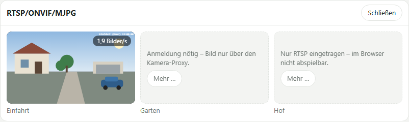

# Changelog – QC-Client

Alle Versionen, neueste oben. Ausführlich mit Bildern: [changelog.html](changelog.html).
Datum = Veröffentlichung auf GitHub; Versionen vor 0.5.5 entstanden vor dem Repo.

## 0.9.62 – Klassische Ansicht am Handy größer
- **Verbessert:** Am Handy (unter 900 px Breite) ist die klassische Ansicht jetzt rund anderthalbmal so groß: Die Bühne ist 453 statt 680 breit. Dafür stehen Funktionszeilen zweizeilig – oben Symbol und Name über die ganze Breite, darunter die drei Felder der Vorlage nebeneinander; Szenentasten nutzen die ganze zweite Zeile. Pro Seite passen halb so viele Funktionszeilen, Raumlisten bleiben einzeilig. Das Menü hat weiter zwei Spalten, jetzt ohne CSS-zoom. Ab 900 px Breite ist nichts geändert.
- Beitrag der Android-Sitzung. Geprüft: Tests gegen den nachgebauten HomeServer und im Android-Emulator (412 × 708, Demo-Visu). Nicht geprüft: echtes Gerät, Vorlagen mit Zeitschaltuhr in der Zeile, Platzhalter „Vorlage fehlt“, Stil „Gira“, eingebettete Webseiten.
- `android/build.ps1`: zwei wahlfreie Parameter `-QcHtml` und `-OutDir` zum Ausprobieren einer anderen `qc.html`; ohne sie unverändert.

## 0.9.61 – Energiefluss: zusätzliche Verbraucher und Zufallswerte
- **Neu:** Der Energiefluss zeigt zusätzliche Verbraucher als kleine Kreise mit Symbol, Leistung und Name – gedacht für bis zu vier Wallboxen, Waschmaschine, Spülmaschine, Trockner und zehn sonstige (höchstens 17). Je Verbraucher wählbar: Name, eines von 16 eigenen Symbolen und der Anschlusspunkt (Haus als Vorgabe, sonst PV, Speicher oder Netz). Die Linie läuft vom Anschlusspunkt zum Verbraucher, bei negativem Wert zurück; ohne Leistung steht ein dünner Strich. Ab 10 kW in kW.
- Die Verbraucher kommen aus den Einstellungen eines **eigenen Plugins 99-3** (ID vorläufig): `<ko id tag>` für die zwölf Grundwerte, `<vb id name icon an tag>` je Verbraucher. Das Plugin 180-1 des Drittanbieters kennt keine Verbraucher. **Das Plugin 99-3 für QuadConfig und den Windows-QuadClient gibt es noch nicht** – bis dahin lassen sich die Verbraucher nur mit den Zufallswerten ansehen. Es gehört ins Repo QC-Plugins. Idee und Vorbild ist das Plugin „Energiefluss“ (180-1); dessen ursprünglicher Autor ist [johannesbonn](https://knx-user-forum.de/member/39809-johannesbonn) aus dem KNX-User-Forum. Aus seinem Paket ist nichts übernommen.
- **Neu:** Der Schalter „Zufallswerte“ (Seitenleiste bzw. System-Menü) gilt jetzt auch für den Energiefluss: alle 5 s neue, in sich stimmige Werte (Netz = PV − Haus ∓ Speicher), gekennzeichnet mit „ZUFALLSWERTE“. Hat die Instanz keine Verbraucher, zeigt der Test neun Beispiel-Verbraucher. Nur Anzeige, es wird nichts gesendet.
- Geprüft: Tests gegen den nachgebauten HomeServer mit erfundenen Einstellungen. Am echten HomeServer noch nicht ausprobiert.

## 0.9.60 – Energiefluss: Linien fließen wieder
- **Behoben:** Die Linien im Energiefluss standen still, wenn im Betriebssystem „Animationen reduzieren“ eingeschaltet ist (so auf dem Rechner, an dem es auffiel). Sie laufen jetzt immer in Flussrichtung – zum Haus hin, beim Laden des Speichers vom Haus weg –, weil die Richtung hier die Aussage ist.

## 0.9.59 – Energiefluss wie im QuadClient
- **Verbessert:** Der Energiefluss (180-1) sieht jetzt aus wie im QuadClient, belegt durch einen Mitschnitt: gefüllte Kreise mit farbigem Symbol, Titel, Wert, darunter „W“ (beim Speicher „W lädt“ / „W entlädt“) und eine Zusatzzeile; Linien nur noch zum Haus und nur, wenn etwas fließt; Fußzeile als eigener Balken mit „Eigenver.“, „Autarkie“, „Einspeisung“, „Netzbezug“ in Farbe und „Live“; kWh mit Punkt und einer Nachkommastelle.
- Vermutung: bei Einspeisung die Linie PV–Netz (so zeigt es das Vorschaubild des Plugins; im Mitschnitt kam keine Einspeisung vor). Symbole weiterhin eigene Zeichnungen.

## 0.9.58 – Plugin „Energiefluss“ (180-1)
- **Neu:** Das Zusatz-Plugin „Energiefluss“ (180-1, Smarthome Hammelrath) wird angezeigt: vier Kreise für PV-Anlage, Speicher, Netz und Haus mit Leistung in Watt, dazu PV-Energie und Verbrauch heute, Ladestand und Zustand des Speichers, in der Fußzeile Eigennutzung, Autarkie, Einspeisung und Netzbezug. Gestrichelte Linien laufen in Richtung des Energieflusses. In „Modern“ und „Klassisch“.
- Belegt aus der Beschreibung des Plugins: die zwölf KOs, Netz positiv = Einspeisung und negativ = Bezug, Speicher-Status 1 = laden, 2 = entladen, sonst Ruhe, die Anordnung der Kreise. Zeichnung und Symbole sind eigene.
- Belegt an einer echten Instanz: Die Einstellungen stehen als Attribute an `<settings>` (ein KO je Name, 0 = nicht belegt). Vermutung: wann welche Linie läuft. Die Anzeige selbst ist bisher nur am nachgebauten HomeServer mit erfundenen Werten geprüft.

## 0.9.57 – Zufallswerte: jede Zeile mit eigenem Wert
- **Behoben:** Hängen mehrere Zeilen oder Kacheln des Ressourcen-Plugins am selben KO, zeigten sie mit Zufallswerten alle dieselbe Zahl. Jetzt bekommt jede Zeile ihren eigenen Wert (am echten HomeServer aufgefallen, dort hängen die Test-Kacheln an einem gemeinsamen Test-KO).

## 0.9.56 – Ressourcen: Zufallswerte zum Ausprobieren
- **Neu:** Im Ressourcen-Plugin lassen sich Zufallswerte einschalten (Menü links: „Ressourcen → Zufallswerte“, in „Klassisch“ im System-Menü „Zufallswerte“). Alle 5 Sekunden bekommen Bilanz, Wertanzeige, Instrument und Diagramm-Kachel neue Werte – so sieht man ohne angeschlossene Zähler, was die Anzeige kann (Bezug/Einspeisung, Speicher, Zeiger, Farbstufen). Solange sie laufen, steht „Zufallswerte“ dabei.
- Nur Anzeige: Es wird nichts an den HomeServer gesendet, die echten Werte bleiben erhalten und andere Elemente zeigen sie weiter. Nicht gespeichert – nach dem Neuladen ist es wieder aus. Die Diagramm-Verläufe aus den Archiven bleiben echt.

## 0.9.55 – Meldeanlage und Alarmzentrale mit Symbolen
- **Verbessert:** Meldeanlage und Alarmzentrale in „Klassisch“ in der Anordnung des QuadClients: Titel oben links, Symbol unten links, rechts ein Zustandsfeld. Das Feld zeigt den Zustand als Symbol (Schild mit Haken = bereit, mit Schloss = scharf, durchgestrichen = nicht bereit, Warndreieck = Alarm) und ist zugleich der Knopf zum Scharf-/Unscharfschalten; Quittung und Überfall haben ihr eigenes Feld. Der Zustand steht zusätzlich als Text da. In „Modern“ steht ein Symbol vor jedem Kacheltitel.
- Die Symbole sind eigene Zeichnungen, keine des Herstellers.

## 0.9.54 – Scharfschalten und Quittieren mit PIN
- **Neu:** Meldeanlage und Alarmzentrale: Bereiche scharf und unscharf schalten und quittieren. Die PIN des QuadClients kann der Client nicht lesen (wo sie liegt, ist nicht bekannt); stattdessen legt man beim ersten Bedienen eine vierstellige PIN fest, die nur auf diesem Gerät gilt – gespeichert wird nur ein Hashwert im Browser. Die Quittung erscheint, solange ein Alarm ansteht.
- Belegt aus QuadConfig: Scharfschalt-Eingang 1 = scharf, 0 = unscharf. Vermutung: Quittung sendet 1. Am echten HomeServer mit internen Test-KOs ausprobiert; an einer echten Meldeanlage oder Alarmzentrale noch nicht – vor dem Einsatz dort bitte selbst prüfen.

## 0.9.53 – Überfall-Alarm als Halteknopf, Feuer-Kachel der Alarmzentrale
- **Neu:** Überfall-Alarm in Meldeanlage und Alarmzentrale: Der Knopf muss wie im QuadClient gedrückt gehalten werden, ein Balken läuft mit; erst danach wird gesendet, Loslassen bricht ab. Haltedauer (2 Sekunden) und gesendeter Wert (1) sind Vermutungen – bitte an der eigenen Anlage prüfen, bevor man sich darauf verlässt. Scharf-/Unscharfschalten und Quittieren gehen weiterhin nicht.
- **Verbessert:** Plugin KNX-Alarmzentrale: Die Kachel „Feuer-Alarm“ steht wie im QuadClient immer da (ohne Alarm: „Kein Alarm“); bei der Meldeanlage erscheint sie weiterhin nur bei Alarm.
- v0.9.52 und v0.9.53 am echten HomeServer angesehen: Balkendiagramme, Ressourcen, Meldeanlage und Alarmzentrale werden mit den Werten der Test-KOs angezeigt, beim Durchklicken wird nichts gesendet. Eine echte Meldeanlage oder Alarmzentrale war nicht angeschlossen.

## 0.9.52 – Alarmzentrale (Anzeige), Balkendiagramme und Meldeanlage in „Klassisch“ wie im QuadClient
- **Neu:** Plugin „KNX-Alarmzentrale“ (1-21) als Anzeige: Zustand der Sicherungsbereiche (auch „Unscharf nach Alarm“), Statusanzeige, Feuer-Alarm und empfangener Überfall-Alarm. Bedienen geht noch nicht; der Client sendet aus diesem Plugin nichts.
- **Verbessert:** Plugin Balkendiagramme in „Klassisch“: Kacheln im Raster aus den Einstellungen (z. B. eine Spalte × drei Zeilen je Seite), Titel oben links, Symbol unten links, Wert groß rechts bzw. bei zwei Reihen die Werteliste, unten die Blätterleiste. Bisher standen die Werte in drei schmalen Spalten ohne Symbol. Antippen öffnet wie bisher das Diagramm.
- **Verbessert:** Plugin Meldeanlage in „Klassisch“ im Aufbau des QuadClients: Kacheln in zwei Spalten, Zustand rechts, Melderliste und Ereignisspeicher als Unteransicht; nichts muss mehr gerollt werden. Die Symbole des Originals fehlen noch, der Zustand steht als Text. Weiterhin nur Anzeige.
- **Behoben:** Plugin Ressourcen in „Klassisch“: Ein langer Titel der Bilanz überdeckte die erste Zeile der Werteliste; die Liste beginnt jetzt unter dem Titel (am echten HomeServer aufgefallen).
- Vorlage waren Bildschirmfotos des QuadClients. Geprüft am nachgebauten HomeServer; an einem echten HomeServer noch nicht.

## 0.9.51 – Plugin „Meldeanlage“ (Anzeige)
- **Neu:** Plugin „Meldeanlage“ (1-15) als Anzeige: Zustand der Sicherungsbereiche (Scharfschaltbereit, Scharf, Alarm, Nicht bereit), Statusanzeige, Melderliste mit Anzahl fehlender oder offener Melder, Ereignisspeicher aus dem Meldungsarchiv; der Feuer-Alarm erscheint nur, solange er ansteht.
- **Bewusst noch nicht:** Scharf- und Unscharfschalten (mit PIN), Quittieren, Überfall-Alarm und Blättern in der Melderliste. Der Client sendet aus diesem Plugin nichts an den HomeServer.
- Die Felder sind aus den Einstellungen in QuadConfig und der Plugin-Beschreibung abgeleitet; die Rangfolge der Zustände (Alarm vor Scharf vor Scharfschaltbereit) ist eine Vermutung. Geprüft am nachgebauten HomeServer und mit einer Test-Einrichtung ohne echte Meldeanlage; an einer echten Anlage noch nicht.

## 0.9.50 – Gebäudestruktur im Menü, Wertanzeige wie im Original
- **Neu:** Menübefehl „Gebäudestruktur anzeigen“: zeigt alle Räume, mit „Strukturierte Liste“ erst die Gebäudeteile. An welcher Nummer der HomeServer diesen Befehl erkennt, ist nicht belegt – der Client erkennt ihn an seinen Angaben; ob das bei echten Projekten trifft, muss ein Test zeigen.
- **Verbessert:** Plugin Wertanzeige in „Klassisch“ wie im QuadClient: feste Kachelgröße, 2 Spalten × 3 Zeilen je Seite, darunter die Blätterleiste. Bisher wurden alle Kacheln auf eine Seite gestaucht, die Schrift wurde winzig. Lange Titel brechen neben der Werteliste um, statt sie zu überdecken; das Symbol ist größer.
- **Verbessert:** Tippt man einen ausgegrauten Menüpunkt an, steht der Grund im Protokoll (Plugin-Art, die der Client noch nicht kann; fehlendes Plugin; unbekannter Befehl) – damit lässt sich gezielt nachbessern.
- Gemeldet von einem Tester aus dem Forum – danke. Geprüft am nachgebauten HomeServer; an einem echten HomeServer noch nicht.

## 0.9.49 – Plugin „Ressourcen“
- **Neu:** Plugin **Ressourcen** (50-1): Bilanz mit Erzeugung, Netz (Bezug/Einspeisung) und Speicher, Zeigerinstrumente, Wertanzeigen und Balkendiagramme – in „Modern“ und im Quadranten der klassischen Ansicht. Beitrag von MarkX81 – danke!
- Bei der Bilanz ist der Aufbau der Einstellungen bekannt; Instrumente, Wertanzeigen und Diagramme liest der Client tolerant und schreibt die Rohdaten ins Protokoll, damit sich nachbessern lässt. Die Symbole kommen vom eigenen HomeServer.
- Die Tests prüfen das Plugin am nachgebauten HomeServer mit erfundenen Einstellungen; an einem echten HomeServer haben wir es selbst noch nicht geprüft.

## 0.9.48 – Tasten mit Schloss aufgeräumt
- **Verbessert:** In der klassischen Ansicht (Stil „Modern“) sitzt das Schloss-Abzeichen weiter in der oberen rechten Ecke der Taste, die Beschriftung rückt ein Stück nach links – beides überlappt nicht mehr.

## 0.9.47 – Raum- und Plugin-Sprung aus importierten Vorlagen
- **Behoben:** Importierte Navigations-Vorlagen (z. B. „Navigation mit Status“) springen jetzt in den Raum bzw. öffnen das Plugin, das in der Funktion eingestellt ist. Bisher erschien beim Antippen nur das Fenster mit allen Einstellungen.
- In „Modern“ zeigt die Kachel je Sprungziel einen Knopf mit dem Namen des Raums oder Plugins; in „Klassisch“ wirken die Tasten der Zeile wie im QuadClient.
- **Behoben:** Nach einem Update arbeitete der Client mit dem im Browser aufgehobenen Projektstand der alten Version weiter, bis das Projekt neu übertragen wurde. Dadurch wirkten der Raum- und Plugin-Sprung und die „Sichtbarkeit im Raum“ aus v0.9.45 zunächst nicht. Der aufgehobene Stand wird jetzt mit der neuen Version neu aufgebaut.
- **Verbessert:** Das Uhr-Symbol der Zeitschaltuhr steht in „Klassisch“ jetzt wie im QuadClient in der dritten Spalte der Zeile (rot = Uhr aus, grün = aktiv) statt neben dem Namen. Nur wenn die Vorlage die dritte Spalte selbst belegt, bleibt es neben dem Namen.
- **Neu:** Im Menü „System“ der klassischen Ansicht steht unten die Versionsnummer des Clients.
- Geprüft am nachgebauten HomeServer mit einer eigenen Test-Vorlage; die Vorlage „Navigation mit Status“ selbst (Statussymbol, PIN-Variante) an einem echten HomeServer noch nicht.

## 0.9.46 – Umlaute im Meldungsarchiv, Zeitschaltuhr in „Klassisch“ direkt erreichbar
- **Behoben:** Der Client erkennt die Zeichenkodierung der Dateien vom HomeServer (Angabe im XML-Kopf, sonst UTF-8 mit Ausweichen auf ISO-8859-1/Windows-1252). Damit stimmen Umlaute im Meldungsarchiv, wenn der HomeServer sie nicht in UTF-8 liefert.
- **Neu:** In der klassischen Ansicht steht bei Elementen mit Zeitschaltuhr ein Uhr-Symbol neben dem Namen (grün = Uhr aktiv). Antippen öffnet die Zeitschaltuhr; bisher ging das nur über den Namen und die Karte mit allen Einstellungen.
- Gemeldet von einem Tester aus dem Forum – danke. Geprüft am nachgebauten HomeServer; an einem echten HomeServer noch nicht – bei den Umlauten ist die Ursache (ISO-8859-1) eine Vermutung.

## 0.9.45 – Sichtbarkeit im Raum, Wertanzeige mit BOOLEAN und TEXT
- **Behoben:** „Sichtbarkeit im Raum (optional)“ aus dem Experten wird beachtet: Ein Element mit Sichtbarkeits-KO erscheint in Raum und Gewerk nur, solange das KO ungleich 0 ist (z. B. nur Lampen, die an sind) – in beiden Ansichten, sofort beim Wechsel des KOs. Bisher wurden immer alle Elemente gezeigt.
- **Behoben:** Plugin Wertanzeige: Beim Format BOOLEAN steht nur noch der passende Text aus der Einheit „wahr/unwahr“ (z. B. „ONLINE“ statt „1 ONLINE/OFFLINE“); beim Format TEXT der Text des KOs ohne Einheit.
- Gemeldet von einem Tester aus dem Forum – danke. Geprüft am nachgebauten HomeServer; an einem echten HomeServer mit solchen Einstellungen noch nicht.

## 0.9.44 – Kamera-Proxy auch in „Klassisch“ einstellbar
- **Neu:** Im Menü „System“ der klassischen Ansicht gibt es den Eintrag „Kamera-Proxy“ mit dem Zustand (aus / eingerichtet). Bisher musste man dafür nach „Modern“ wechseln.

## 0.9.43 – Eigenes Kamera-Plugin „RTSP/ONVIF/MJPG“ (99-2)
- **Neu:** Der Client zeigt das eigene Kamera-Plugin 99-2 aus dem Plugin-Projekt an – bisher stand dort „Dieses Plugin kann der Client noch nicht“. Anzeige und Bedienung wie beim Kamera-Plugin 0-2 (alle Kameras, Einzelansicht, klassische Ansicht).
- RTSP kann kein Browser abspielen: Der Client nimmt die Standbild-Adresse (bzw. den MJPEG-Strom). Verlangt die Kamera eine Anmeldung, läuft das Bild über den Kamera-Proxy (Logikbaustein 14783, Zuordnung über den Kameranamen); Benutzer und Passwort aus dem Plugin übernimmt der Client nicht.
- Das KO „Anzeigen“ einer Kamera schaltet wie im Windows-Plugin auf diese Kamera um.
- **Verbessert:** Kamera-Kacheln ohne Bild zeigen einen kurzen Hinweis; Antippen öffnet die Kamera mit der ganzen Erklärung (kein Proxy eingetragen, Proxy nicht erreichbar oder Kamera dort unbekannt). Gilt auch für das Kamera-Plugin 0-2.

- Geprüft am nachgebauten HomeServer; an einem echten HomeServer noch nicht.

## 0.9.42 – Versuch: Gira-Addins im Client
- **Neu (Versuch, standardmäßig aus):** Ab Experte 4.13 liegen zu manchen Plugins „Addins“ auf dem HomeServer – die Webseiten, die Giras neuer HTML5-Client (G1 der 2. Generation) anzeigt. Mit dem Schalter „Gira-Addins“ in der Seitenleiste zeigt der Client für die **Wettervorhersage** (Plugin 1-3) dieses Addin im Plugin-Feld bzw. im Quadranten statt des eigenen Nachbaus. Der Client übergibt die Einstellungen der Instanz, meldet KO-Änderungen und setzt KOs, wenn das Addin bedient wird.
- Das Addin wird nur vom eigenen HomeServer geladen und läuft abgeschottet (kein Zugriff auf die Seite und ihren Speicher). Der Client bringt keine Gira-Dateien mit.
- Antwortet das Addin nicht oder fehlen seine Einstellungen, erscheint wieder das eigene Plugin.
- **Noch offen:** Einstellungen „für alle“ auf dem HomeServer speichern (lesen geht), Archivdaten für Diagramm-, Meldungs- und Kamera-Addin, weitere Addins. Geprüft am nachgebauten HomeServer mit einem eigenen Test-Addin und mit Giras Wetter-Addin im Testbrowser; an einem echten HomeServer mit Anmeldung noch nicht.

## 0.9.41 – Handy-Plugin-Seite auch auf älteren WebViews
- **Korrigiert:** Die Plugin-Seite der klassischen Ansicht auf dem Handy nutzt für die normale Schriftgröße jetzt eine Transformation statt CSS-`zoom`. Unter `zoom` rechnen ältere Android-WebViews (vor Chromium 128) Positionen anders, das Fadenkreuz in Diagrammen hätte dort neben dem Finger gesessen. Aussehen unverändert.
- README: Vorschaubild der neuen Plugin-Seite.

## 0.9.40 – Klassisch auf dem Handy: ein Plugin in voller Größe
- **Geändert:** Die Plugin-Seite der klassischen Ansicht zeigt auf dem Handy nur noch **ein** Plugin über die ganze Seite (nach dem Vorbild der Gira-App) statt zwei verkleinerter Quadranten. Eine Auswahlzeile „‹ Name ›“ blättert durch alle Plugins; der Titel nennt das Plugin. Der Inhalt nutzt die bewegliche Darstellung in normaler Schriftgröße (Diagramm, Kamera, Wetter … über die volle Breite).
- **Geändert:** Auf dem Handy läuft ein Plugin nur, solange die Plugin-Seite offen ist (Kamera-Ströme enden beim Wechsel zu Menü oder Liste).
- Auf Tablet und PC (ab 900 Pixel) bleibt es bei vier Quadranten.
- README: Vorschaubilder der Android-App.

## 0.9.39 – Anmeldung: klare Meldung und Diagnose
- **Neu:** Scheitert die Anmeldung, prüft der Client, ob der HomeServer überhaupt erreichbar ist, und sagt genauer, woran es liegt: Adresse/Zertifikat (HS nicht erreichbar), Anmeldung abgelehnt (Benutzer/Passwort, Benutzer ohne QuadClient, Sperre) oder keine Antwort.
- **Neu:** Unter der Meldung steht ein Diagnosetext mit Knopf „Diagnose kopieren“ – für Rückfragen. Er enthält Version, Art des Aufrufs, Ergebnis des HTTPS-Abrufs, Code und Dauer der WebSocket-Verbindung, Browser und die letzten Protokollzeilen, aber weder Adresse noch Benutzername oder Passwort.
- **Korrigiert:** Ein gemerktes Passwort wird nach einer gescheiterten Anmeldung verworfen. Bisher meldete sich die Seite bei jedem Neuladen von selbst wieder an und verlängerte so die Sperre des HS.

## 0.9.38 – Kamera bleibt stehen, Helligkeit passt
- **Korrigiert:** Das Kamerabild wurde immer wieder neu aufgebaut („0,0 Bilder/s“), wenn daneben ein Plugin mit oft sendenden KOs lief (Wetter 99-1 oder 1-3 mit Station, Wertanzeige 1-2). Ursache: Jedes Telegramm zeichnete alle Plugin-Anzeigeorte neu. Jetzt wird nur der Anzeigeort neu gezeichnet, dessen Plugin das KO benutzt; auch Bedienung in einem Plugin (Zeitraum, Archiv, Kamera wählen) lässt den anderen Quadranten in Ruhe.
- **Korrigiert:** Klassisch, Wetter 99-1: Die Helligkeit je Himmelsrichtung („N … · O … · S … · W … klx“) ragte über die Spalte „Jetzt“ hinaus. Lange Texte (über 24 Zeichen) stehen jetzt kleiner und in zwei Zeilen.

## 0.9.37 – Eigenes Wetter-Plugin 99-1
- **Neu:** Das eigene Plugin „Wetter“ (vorläufig 99-1, siehe [QC-Plugin](https://github.com/BadSmiley0815/QC-Plugin)) wird angezeigt – Anzeige wie beim Wetter 1-3 (Modern und Klassisch), aber Ort, Intervall, Einheiten und die KOs der Wetterstation kommen aus den Projektdaten der Instanz auf dem HS. Am Gerät wird nichts eingestellt (kein Zahnrad).
- **Neu:** „Jetzt“ nimmt Stationswerte vor Open-Meteo: Temperatur (mit „gemessen“), gefühlte Temperatur, Feuchte, Wind (Umrechnung m/s ↔ km/h nach Einstellung), Windrichtung, Regen ja/nein, Helligkeit (ein Wert in lx oder je Himmelsrichtung in klx), Luftdruck (Pa oder hPa). Ohne Ort: Hinweis „Kein Ort eingestellt – im Experten eintragen.“
- **Neu:** Die letzte Vorhersage bleibt mit Zeitstempel stehen, wenn Open-Meteo nicht erreichbar ist; gespeichert je Ort und Einheiten.
- Das Wetter-Plugin 1-3 mit seiner Einstellung je Gerät bleibt unverändert.

## 0.9.36 – Klassische Ansicht auf dem Handy
- **Neu:** Die klassische Ansicht läuft auch im schmalen Fenster (unter 900 Pixel Breite, also auf dem Handy): eine Spalte statt vier Quadranten. Menü und Listen nutzen die ganze Höhe (Menü in zwei Spalten mit größeren Kacheln, Listen mit so vielen Zeilen, wie passen); die beiden Plugin-Quadranten sind eine eigene Seite, erreichbar über „Plugins“ in der Leiste unten. Ein Plugin aus dem Menü öffnet direkt diese Seite.
- **Geändert:** Die Meldung „Die klassische Ansicht braucht ein breites Fenster“ entfällt. Auf Tablet und PC (ab 900 Pixel) bleibt es bei vier Quadranten; beim Drehen des Geräts wechselt die Aufteilung von selbst.

## 0.9.35 – Diagramme mit dem Finger abfahren
- **Korrigiert:** Auf dem Handy folgte das Fadenkreuz in Diagrammen (0-3) und Balkendiagrammen (1-16) dem Finger nicht – nur Antippen ging. Ursache: Das Neuzeichnen ersetzte das berührte Element, weitere Fingerbewegungen kamen nicht mehr an. Jetzt läuft das Fadenkreuz beim Ziehen mit.
- **Neu:** QC-Client als Android-App: kleine Hülle unter [`android/`](android/README.md), die `qc.html` mitbringt und das Zertifikat des HomeServers einmal bestätigen lässt. Eigene Änderungen der Hülle: [`android/CHANGELOG.md`](android/CHANGELOG.md).

## 0.9.34 – Wetterstation als Funktionsvorlage
- **Neu:** Das Wetter-Plugin nimmt „Jetzt“ auch aus Elementen mit der eigenen Funktionsvorlage „Wetterstation“ (vorläufig 99-4, siehe [QC-Funktionsvorlagen](https://github.com/BadSmiley0815/QC-Funktionsvorlagen)); sie hat Vorrang vor einer Wertanzeige.

## 0.9.33 – Wetter
- **Neu:** Plugin Wetter (1-3) als eigene Lösung statt des Gira-Diensts: Vorhersage für 7 Tage von Open-Meteo (Wetter-Symbol, Min/Max mit Temperaturbalken, Regenmenge und -wahrscheinlichkeit, Wind mit Richtungspfeil).
- **Neu:** „Jetzt“ mit den Werten einer Wetterstation: eine Wertanzeige (1-2) auf dem HS liefert die KOs, erkannt an der Bezeichnung (Temperatur, Wind, Windrichtung, Regen, Feuchte, Helligkeit, Luftdruck); ohne Station die Außentemperatur der Kopfzeile bzw. Open-Meteo.
- **Neu:** Ort je Gerät über Ortssuche oder Gerätestandort (Zahnrad); Intervall und Einheiten aus der Plugin-Einstellung des HS. Die Geräteportal-Kennung wird nicht verwendet.
- **Neu:** Klassisch: „Jetzt“ links, 4 Tage rechts, mit ◀ ▶ blättern. Offline bleibt die letzte Vorhersage mit Stand stehen.

## 0.9.32 – Popup-Feinschliff
- **Korrigiert:** Wertfelder in Popups zeigen die Bezeichnung nur noch, wenn das Layout dafür eine Zelle hat – wie im Original (bisher lag z. B. „Position Behang“ über dem Wert).
- **Geändert:** Stil „Modern“: Schieberegler in Popups schlank (schmale Spur, Griff als Pille) statt breiter Balken.
- **Geändert:** Antippen des Namens öffnet bei Gira-Vorlagen dasselbe Popup wie das Antippen des Werts (z. B. Dimmer) statt des Einstellungsfensters.
- **Neu:** Öffnet ein Gira-Popup noch das Einstellungsfenster, nennt das Protokoll den Grund (z. B. „Aktion „sc_learn““).

## 0.9.31 – Wertanzeige ohne Scrollen
- **Geändert:** Die Wertanzeige in der klassischen Ansicht teilt den Quadranten unter allen Kacheln auf (2 Spalten, Zeilenhöhe nach Anzahl); Schrift, Wert und Symbol passen sich an – kein Scrollen mehr.

## 0.9.30 – Symbole der Plugins
- **Korrigiert:** Die Kacheln der Wertanzeige (Plugin 1-2) zeigten keine Symbole. Plugin-Symbole liegen auf dem HS je Plugin unter `/quad/plugins/design_0/icons/<Plugin>_icons.xaml.zip` – der Client lädt sie jetzt von dort (z. B. `1-2_strom`, `1-2_zaehler`, `1-2_helligkeit`). Der Symbol-Zwischenspeicher wird dafür einmal neu aufgebaut.

## 0.9.29 – Live-Strom vom Client gelesen
- **Korrigiert:** Die Bilder/s-Messung bei Live-Strömen (Prüfung des angezeigten Bildes) war unzuverlässig: Der Browser liefert bei MJPEG-Bildern oft nur das erste Einzelbild an die Messung. Dadurch stand „0,0 Bilder/s“ bei flüssigem Bild, und der Wächter aus 0.9.27 verband alle 8 s unnötig neu.
- **Neu:** Live-Ströme über den HS (Kamera-Proxy) liest der Client jetzt selbst: Er holt den MJPEG-Strom, zerlegt ihn in Einzelbilder (Länge aus dem Teil-Kopf, sonst JPEG-Ende) und zeigt sie an. Bilder/s sind damit exakt; reißt der Strom ab, verbindet der Wächter nach 8 s neu. Ströme direkt von der Kamera (fremde Adresse) bleiben normale Bilder mit Anzeige „Live“ und ohne Wächter.

## 0.9.28 – Menü-LED
- **Geändert:** Stil „Modern“: Die Zustands-LED der Menü-Kacheln sitzt etwas höher, auf Höhe der Zähler, statt am unteren Rand der abgerundeten Kachel.

## 0.9.27 – Kamera-Ströme erholen sich selbst
- **Korrigiert:** Lief ein Live-Strom (Kamera-Proxy) länger, konnte er abreißen – Bild halb weiß, „0,0 Bilder/s“, und es tat sich nichts mehr. Ein Wächter verbindet jetzt neu, sobald 8 s lang kein neues Bild kommt (auch bei schnellen Endpunkt-Kameras); das Protokoll vermerkt es. Nach dem Wechsel aus dem Hintergrund startet der Wächter neu, statt sofort zu verbinden.

## 0.9.26 – Gira-Popups im Original-Stil
- **Neu:** Auch bei Gira-Vorlagen (Jalousie, Heizung, Dimmer, Szenen-Popup …) öffnet das Antippen eines Felds jetzt das Popup der Vorlage im Original-Stil (bzw. Stil „Modern“) statt des modernen Einstellungsfensters – sofern der Client alle Elemente und Aktionen des Popups beherrscht (Tasten, Wertfelder, Schieberegler, Texte, Symbole; Setzen, Umschalten, Schritt, Schließen, weiteres Popup). Popups mit Szene lernen/abrufen, Abläufen, Navigation oder PIN-Verwaltung öffnen vorerst weiter das Einstellungsfenster. Der Name einer Funktion öffnet weiterhin das Einstellungsfenster.
- **Geändert:** PIN-Abfrage vor solchen Popups und Aktionen direkt aus der Vorlage (PIN-KO), auch bei Gira-Vorlagen.

## 0.9.25 – Jalousie in der klassischen Ansicht
- **Korrigiert:** Die Pfeiltasten der Jalousie (1-107) reagierten in der klassischen Ansicht nicht. Die Vorlage legt die Tasten-Aktionen in eine Gruppe („nur ohne Sperre“), die der Client bei Klickflächen und Aktionen nicht durchsucht hat. Betrifft alle Vorlagen mit Aktionen in Gruppen.

## 0.9.24 – Mehr Symbole aus der QC-Visu
- **Korrigiert:** Symbole mit Linien, Polylinien/Polygonen oder ausführlich notierten Pfaden (PathFigure mit Segmenten, GeometryGroup, Ellipse-/Rechteck-/Liniengeometrie) konnte der Client nicht umsetzen und zeigte ein Ersatzsymbol (z. B. Haus statt Lineal beim Menüpunkt „Büro“, `mnu_btn_ico_techoffice`). Diese Formen werden jetzt gezeichnet; der Symbol-Zwischenspeicher wird dafür einmal neu aufgebaut.
- **Neu:** Das Protokoll nennt fehlende („nicht im Symbolsatz“) und nicht umsetzbare Symbole beim Namen.
- **Korrigiert:** Menü-LEDs zeigen die im Experten eingestellten Farben für Ein und Aus (`color_on`/`color_off`: rot, grün, blau, gelb, weiß, orange). Bisher war Aus immer grau – z. B. „Essplatz sperren“ (Aus = grün) war im Windows-QC grün, im Client grau. Zähler nehmen ihre eingestellte Farbe an.

## 0.9.23 – Szenen-Tasten gleichmäßig
- **Geändert:** Szene/Auslöser 1- bis 4-fach (1-109) verteilt die Tasten im Stil „Modern“ gleichmäßig über beide Felder: 1-fach über die ganze Breite, 2-fach halb/halb, 3-fach in Dritteln, 4-fach in Vierteln. Kurz/lang drücken (Szene abrufen, Lernen) wie in der Vorlage. Im Stil „Gira“ bleibt die Original-Aufteilung.
- **Korrigiert:** Die Trennlinien zwischen den Feldern fangen keine Klicks mehr ab.

## 0.9.22 – Bilder/s bei jeder Kamera
- **Neu:** Die Anzeige „Bilder/s“ steht jetzt an jedem Kamerabild – Einzelansicht, Mehrfachansicht und klassische Quadranten, bei Einzelbildern und MJPEG-Strömen (Kamera-Proxy). Ströme werden über eine Mini-Leinwand auf Bildwechsel geprüft; direkt eingebundene Kameras ohne Freigabe für fremde Seiten zeigen „Live“.

## 0.9.21 – Diagramm mit Maus, Wertanzeige im Original-Aufbau
- **Neu:** Diagramme in der klassischen Ansicht zeigen beim Überfahren mit der Maus (bzw. Antippen) eine Linie, Punkte auf den Kurven und ein Kästchen mit Zeitraum und allen Werten.
- **Neu:** Wertanzeige (Plugin 1-2) in der klassischen Ansicht wie im Windows-QC: Kacheln in zwei Spalten mit Titel, Symbol und großem Wert bzw. Werteliste – im Stil „Modern“ mit runden, plastischen Kacheln. Symbole der Kacheln werden aus dem Symbolsatz des HS geladen.

## 0.9.20 – Aktionen auf nicht verbundene Slots
- **Korrigiert:** Setzte eine Taste im Popup zusätzlich einen nicht verbundenen Slot (z. B. Frostschutz bei der Betriebsartenumschaltung 1-20), öffnete sich statt der Umschaltung das Einstellungsfenster. Solche Aktionen werden jetzt wie im Original übersprungen.

## 0.9.19 – Name antippen öffnet das Popup
- **Geändert:** Bei Funktionen, deren Popup der Client aus der Vorlage zeichnet (z. B. Betriebsartenumschaltung 1-20, importierte Vorlagen), öffnet das Antippen des Namens direkt das Popup statt erst das Einstellungsfenster mit „Bedienen“.

## 0.9.18 – Schloss im Kreis
- **Korrigiert:** Das Schloss-Symbol saß unter dem schwarzen Kreis statt darin (Symbol als Inline-Grafik auf der Textgrundlinie). Jetzt genau im Kreis; im Stil „Modern“ rückt das Abzeichen etwas ins abgerundete Feld.

## 0.9.17 – Menü-Kacheln
- **Korrigiert:** Die Menü-Kacheln der klassischen Ansicht hatten keinen Hintergrund mehr (nur leere Kacheln waren grau).
- **Geändert:** Stil „Modern“: Kacheln plastisch mit leichtem Verlauf, Lichtkante oben, Schatten und runden Ecken, geben beim Antippen nach; Zähler abgerundet; aktiver Eintrag der unteren Leiste mit grüner Kante.

## 0.9.16 – Klassisch im modernen Stil
- **Neu:** Stil „Modern“ für die klassische Ansicht (Standard): Aufbau und Raster wie beim Gira-QuadClient, Optik zeitgemäß – abgerundete Felder mit Abstand, Popups mit runden Ecken, Schatten, unscharfem Hintergrund und kurzer Einblendung, flache Knöpfe (aktiv grün gefüllt), feine grüne Linie unter der Überschrift, moderne Schrift mit gleich breiten Ziffern.
- **Neu:** Umschalter „Stil Klassisch: Modern / Gira“ in den Einstellungen bzw. „Stil wechseln“ im System-Menü der klassischen Ansicht.

## 0.9.15 – Popups näher am Windows-QC
- **Korrigiert:** „+“ und „−“ in Popups (`action_repeat`) reagierten nur bei langem Drücken; jetzt sofort beim Antippen, beim Halten mit Wiederholung. Schrittweite auch aus `def_value`.
- **Geändert:** Wertfelder wie im Original: Bezeichnung (`info`) oben links, Wert groß rechtsbündig mit kleiner Einheit, Rahmen aus dem Layout (`edit_2`/`edit_3`).
- **Geändert:** In „Klassisch“ öffnet das Popup im Maßstab der Ansicht über der Liste auf Höhe der angetippten Zeile; die Zeile bleibt markiert, solange Popup oder Einstellungsfenster offen sind.
- **Korrigiert:** Knöpfe ohne Aktion (reine Statusanzeige) werden nicht mehr abgeblendet.

## 0.9.14 – Abzeichen wie im Windows-QC
- **Geändert:** Schloss und Zweitfunktion (z. B. „AUTO“) sitzen wie im Windows-QuadClient in einem kleinen schwarzen Kreis oben rechts im Feld.

## 0.9.13 – Musiksteuerung: Taste „zurück“
- **Korrigiert:** Fehlt im Symbolsatz des HS ein „…_back“-Symbol (z. B. `tpl_pop_media_ico_skip_back` bei der Musiksteuerung 5-91), zeigt der Client das passende „…_forward“-Symbol gespiegelt statt einer leeren Taste.

## 0.9.12 – Vorlagen-Logik: umgekehrte Eingänge
- **Korrigiert:** In der Vorlagen-Logik wurde `inverse="true"` an einzelnen Eingängen (`<slot … inverse="true"/>`) nicht beachtet. Folgen u. a. bei der Betriebsartenumschaltung (1-20): Soll- und Ist-Anzeige übereinander, Popup ließ sich nicht öffnen (Freigabe „ändern ohne PIN“ immer aus). Betrifft alle Vorlagen mit solcher Logik.
- **Korrigiert:** Sichtbarkeit mit `visible_slot` + `from`/`to` am Element wird als Bereich geprüft.

## 0.9.11 – Schloss-Abzeichen
- **Geändert:** Das Schloss (PIN) und andere Abzeichen in den Feldern der Ansicht „Klassisch“ sitzen jetzt in einem kleinen runden, halbtransparenten Kreis statt auf einem harten grauen Quadrat.
- **Neu:** Das Protokoll zeigt, welches Popup bzw. Einstellungsfenster für welche Funktion geöffnet wird.

## 0.9.10 – Popups: Schieberegler, alle Knöpfe
- **Neu:** Schieberegler in Popups (waagrecht und senkrecht), Wert wird beim Loslassen gesendet.
- **Korrigiert:** Knöpfe und Wertfelder, die über `layout="grid1.F2-G2+pop_btn_1"` platziert sind, fehlten (z. B. „Ab“ und „−“ bei der Jalousie mit Lamelle).
- **Neu:** Popups mit `close_slot` schließen sich selbst (z. B. bei Sperre/Zwangsführung).
- **Korrigiert:** Vorlagendateien mit BOM werden gelesen.

## 0.9.9 – Popups: Lage wie im Original
- **Korrigiert:** Popup-Elemente mit `layout="grid3.A1-A2+pop_btn_list.bg"` (Raster + Layoutzelle) lagen alle oben links übereinander (z. B. Listenzeilen und Symbole der Musiksteuerung 5-91). Jetzt an der richtigen Stelle; Texte links/rechts nach der Layoutzelle, Knopf-Symbole und -Texte in den Zellen `icon3`/`text1`.

## 0.9.8 – Importierte Funktionsvorlagen
- **Neu:** Importierte (nicht von Gira stammende) Funktionsvorlagen: Der Client sucht ihre Beschreibung zusätzlich im public-Bereich des HS (`/quad/public/…/public_templates.xml`, `public_language.xml`, `public_design.xml`) und schreibt ins Protokoll, was er gefunden hat und welche Vorlagen fehlen.
- **Neu:** Popups dieser Vorlagen erscheinen im Original-Stil (Raster, Knöpfe mit Markierung des aktuellen Werts, Werteingabe, OK), auch mit PIN-Abfrage. Die moderne Kachel zeigt die Texte der Felder und einen Knopf „Bedienen“ statt „unknown“.
- **Geändert:** Fehlt die Beschreibung einer Vorlage, steht in der Zeile „Vorlage … fehlt“ statt „…“.

## 0.9.7 – Jalousien mit Lamelle bedienbar
- **Behoben:** Die QC-Vorlage „Jalousie mit Lamellenverstellung“ (1-123) wurde nicht erkannt: Kachel ohne Knöpfe, Status „unknown“. Jetzt mit Auf/Stopp/Ab, Position und zusätzlich einem Regler für die Lamelle.

## 0.9.6 – 2026-11-11 – Klare Meldung bei falschem Passwort
- **Behoben:** Bei falschem Benutzer oder Passwort blieb die Anmeldung auf „Verbinde …“ stehen, weil der HomeServer die Verbindung ohne Antwort offen lässt. Jetzt bricht der Client nach 10 Sekunden ab und meldet „Benutzername oder Passwort falsch?“.

## 0.9.5 – 2026-11-11 – Seitenleiste ausblendbar, Webseiten in voller Höhe
- **Neu:** Mit ☰ oben links lässt sich die Seitenleiste auch am großen Bildschirm aus- und einblenden; der Client merkt sich die Einstellung.
- **Behoben:** Webseiten aus dem Menü (Typ Webseite) sind mindestens so hoch wie der Bildschirm. Seiten, die sich nach der Fensterhöhe richten (z. B. Grundriss, Szenen-Seite), wurden vorher winzig dargestellt.

## 0.9.4 – 2026-11-10 – Eigene Symbole aus Funktionsvorlagen
- **Neu:** Symbole, die mit einer eigenen Funktionsvorlage (Symbolpaket .hsm) importiert wurden, lädt der Client wie der Windows-QC zusätzlich aus `/quad/public/design_0/public_icons.xaml.zip`.

## 0.9.3 – 2026-11-10 – Kameras über den Kamera-Proxy
- **Neu:** Einstellung „Kamera-Proxy“ links in der Navigation: Adresse des Logikbausteins 14783 und Schlüssel, nur auf diesem Gerät gespeichert, beim Speichern geprüft.
- **Neu:** Kameras, deren Name zum Namen im Baustein passt, laufen über den Proxy – Kameras mit Anmeldung und reine http-Kameras zeigen Standbilder und in der Einzelansicht den Live-Strom. Im Experten bleibt das Kamera-Plugin unverändert.

## 0.9.2 – 2026-11-10 – Kamera über den HS fast live
- **Neu:** Kameras, deren Bild über einen Endpunkt des HomeServers kommt, laufen in der Einzelansicht fast live: nächstes Bild, sobald das vorige da ist (höchstens 5 Bilder pro Sekunde), mit Anzeige der Bilder pro Sekunde.
- **Korrigiert:** Knopf „Kamera einmal öffnen und anmelden“ entfernt – die doppelte Anmeldung hat nicht zuverlässig funktioniert. Der Hinweis nennt jetzt den Weg über einen HS-Endpunkt.

## 0.9.1 – 2026-11-09 – Plugins im Original-Stil
- **Neu:** In der Ansicht „Klassisch“ sehen Diagramm (eine Grafik, zwei Achsen, Rot/Grün/Blau, Pfeilmarken, Zeitraum mit ◀ ▶), Sonos (Cover, Knopfreihe, Lautstärke) und Kameras (◀ Name ▶, Übersicht) aus wie im Windows-QuadClient.

## 0.9.0 – 2026-11-09 – Ansicht „Klassisch“
- **Neu:** Zweite Ansicht wie der Windows-QuadClient: Kopfzeile mit Datum, Uhrzeit, Außen-/Innentemperatur, Menü in drei Spalten mit Zählern, zwei Plugin-Quadranten mit Reitern, Leiste Menü/Favoriten/System. Umschaltbar, skaliert aufs Fenster.
- **Neu:** Raumzeilen werden aus den Vorlagen des HomeServers gezeichnet und bedient – genau wie im Original, auch eigene Funktionsvorlagen.
- **Noch offen:** Popups der Vorlagen (öffnen vorerst die moderne Kachel), Plugins im Original-Stil.

## 0.8.0 – 2026-11-09 – Originale Symbole
- **Neu:** Menü, Räume und Elemente zeigen die Symbole aus der QC-Visu. Der Client holt sie vom eigenen HomeServer, wandelt sie im Browser in Vektorgrafik um und merkt sie sich – passend zu Hell und Dunkel.
- **Neu:** Fehlt ein Symbol oder ist es nicht umwandelbar, bleibt das eigene Ersatzsymbol.

## 0.7.2 – 2026-11-09 – Kamera live
- **Neu:** Plugin Kamera: alle Kameras als Kacheln, Einzelansicht mit Livebild bzw. schneller Bildfolge, Schaltknöpfe (z. B. Licht) wie im Original.
- **Neu:** Ist eine Kamera im Browser nicht erreichbar (http, Anmeldung), erscheint ein verständlicher Hinweis statt eines kaputten Bildes.
- **Neu:** Kamera-Zugangsdaten aus der Visu werden nicht übernommen, Kamera-Adressen nie angezeigt oder ins Log geschrieben.

## 0.7.1 – 2026-11-09 – Balkendiagramme
- **Neu:** Plugin Balkendiagramme: Übersicht mit aktuellen Werten, je Eintrag 24 h, 7 Tage, 28 Tage, 52 Wochen; eine oder zwei Reihen, Statistik Min/Max/Mittel/Summe, Werte beim Darüberfahren. Regeln wie im Original-QuadClient.

## 0.7.0 – 2026-11-09 – Diagramme
- **Neu:** Plugin Diagramm: Stunde, Tag, Woche, 4 Wochen, Jahr – Blockgrößen, Startzeiten und Min/Mittel/Max genau wie im Original-QuadClient.
- **Neu:** Fadenkreuz mit allen Werten zum Zeitpunkt (Maus oder Finger), aktuelle Werte in der Legende, Lücken bei fehlenden Daten, Zeitachse auf runden Uhrzeiten.
- **Neu:** Zwei Einheiten (z. B. °C und %) als zwei Diagramme übereinander statt zweier Y-Achsen – besser lesbar.

## 0.6.3 – 2026-11-09 – Meldungsarchiv
- **Neu:** Plugin Meldungsarchiv: neueste Meldungen zuerst, mit Datum, mehrere Archive als Reiter, automatisches Nachladen wie eingestellt.
- **Neu:** Suche in den Meldungen – gibt es im Original nicht.

## 0.6.2 – 2026-11-09 – Kamera-Archiv
- **Neu:** Plugin Kamera-Archiv: neuestes Bild zuerst, vor/zurück blättern, Bild direkt aus der Zeitliste wählen, mehrere Kameras als Reiter. Abruf wie im Original-QuadClient.

## 0.6.1 – 2026-11-09 – Sonos
- **Neu:** Plugin Sonos: alle Player mit Titel, Interpret, Cover, Lautstärke; Abspielen/Pause, Stopp, Weiter/Zurück, Lauter/Leiser, Stumm, Zufall, Wiederholen, Gruppe. Sendewerte aus dem Original-Plugin ausgelesen statt geraten.
- **Neu:** Plugins sind jetzt Bausteine: ein neues Plugin ist ein zusätzlicher Eintrag, der Rest bleibt unberührt.

## 0.6.0 – 2026-11-09 – Erstes Plugin: Wertanzeige
- **Neu:** Menüpunkte, die ein Plugin aufrufen, werden erkannt. Die Wertanzeige (z. B. Zählerstände Bezug, Lieferung, PV) öffnet sich unter den Kacheln und aktualisiert sich live.
- **Neu:** Der Client lädt nur Einstellungen von Plugins, die er darstellen kann – Kamera-Einstellungen mit Zugangsdaten werden gar nicht erst abgerufen.
- **Noch offen:** Kamera, Diagramme, Archive, Sonos, Wetter.

## 0.5.6 – 2026-11-09 – Jetzt verbinden
- **Neu:** Knopf „Jetzt verbinden“ im Hinweis „Verbindung getrennt“ – kein Warten auf den Countdown mehr. Während einer Anmeldesperre heißt er „Trotzdem verbinden“ und warnt, dass ein Versuch die Sperre verlängern kann.

## 0.5.5 – 2026-11-09 – Bereit für GitHub
- **Korrigiert:** Keine feste HS-Adresse mehr voreingestellt.
- **Korrigiert:** Szenen mit mehreren Tasten ordnen sich als Raster an.
- **Neu:** Browser-Tests mit erfundener Demo-Visu, Protokoll-Notizen.

## 0.5.4 – Eingebettete Webseiten richtig vermessen
- **Korrigiert:** Höhe des Felds stimmt jetzt auch bei fest positionierten Seiten wie der alten HS-Visu 1366×768.

## 0.5.3 – Immer über https
- **Neu:** Aufruf über http:// leitet automatisch auf https:// um – gleiche Herkunft wie die HS-Seiten, Zwischenablage funktioniert, Anmeldung nicht doppelt.

## 0.5.2 – Feld passt sich dem Inhalt an
- **Neu:** Eingebettete Seiten vom HomeServer bekommen genau die Höhe ihres Inhalts; fremde Seiten bleiben bildschirmhoch.

## 0.5.1 – Webseiten im Menü eingebettet
- **Neu:** Webseiten aus dem Menü öffnen sich unter den Kacheln statt in einem neuen Tab.
- **Neu:** Leiste mit Name, „In neuem Tab öffnen“ und „Schließen“ – die Adresse wird nicht angezeigt.

## 0.5 – Das QC-Menü als Startseite
- **Neu:** Menü wie in der QuadConfig: Raum, Gewerk, Etage, Webseite, KO umschalten, Unterseiten, PlugIns-Seite.
- **Neu:** Jeder Benutzer sieht nur die Einträge seiner Benutzergruppe.
- **Neu:** Zähler-Badges und Ein/Aus-Farbe live.
- **Neu:** Startseite wählbar: Menü, Favoriten oder zuletzt geöffnet.
- **Offen:** „KO umschalten“ noch gegen das Original prüfen.

## 0.4.1 – Feinschliff
- **Korrigiert:** Uhr-Symbol überdeckt lange Namen nicht mehr.
- **Neu:** Dateiname ab jetzt qc.html.

## 0.4 – Alle Schaltuhren bearbeitbar
- **Neu:** Alte Schaltpunkte änderbar – der Client schreibt sie wie das Original ins aktuelle Format um.
- **Neu:** Neue Arten: Zufall (Uhrzeit + Spanne), Sonnenaufgang plus/minus Offset.
- **Offen:** „Sonnenuntergang minus“ noch nicht mitgeschnitten.

## 0.3.3 – Log kopieren
- **Neu:** Knopf „Log kopieren“ mit Version, HS-Adresse und Uhrzeit – ohne Passwort.

## 0.3.2 – Vorlagen gefunden
- **Korrigiert:** Fehler 403 behoben: Vorlagen kommen aus /quad/client/design_4/.

## 0.3.1 – Visu immer aktuell
- **Korrigiert:** Visu wird bei jeder Anmeldung mit dem HS abgeglichen – auch nach dem Übertragen mit gleicher Projekt-ID.
- **Neu:** Versionsnummer oben im Menü.

## 0.3 – Schaltuhren
- **Neu:** Uhr-Symbol auf jeder Kachel mit Schaltuhr; Uhr ein/aus.
- **Neu:** Schaltpunkte anlegen, ändern, löschen: Uhrzeit, Sonnenuntergang plus, Wochentage, Sondertage, Aktion aus der Vorlage.

## 0.2.2 – Neustart erkennen
- **Neu:** HS nicht erreichbar → neuer Versuch alle 5 s; Anmeldung abgelehnt → 90 s warten (Sperre nach Fehlversuch).

## 0.2.1 – Rückwärtszähler
- **Neu:** Zeigt die Sekunden bis zum nächsten Verbindungsversuch.

## 0.2 – Alle QC-Funktionen aus dem Testraum
- **Neu:** Taster in allen Varianten (Flanke 1/0, Impuls 1/0).
- **Neu:** Schalten mit PIN, Szene abrufen und speichern, Werteingabe, Müll.
- **Neu:** Prozentanzeige beim Ziehen, Weiß-Regler für RGB.
- **Korrigiert:** Dunkle Scrollbalken, Betriebsart-Tasten auf dem Handy.

## 0.1 – Der erste eigene QuadClient
- **Neu:** Anmeldung mit HS-Adresse, Benutzer, Passwort – Visu kommt vom HS.
- **Neu:** Live-Werte, Favoriten, Räume nach Etagen, Gewerke.
- **Neu:** Schalten, Dimmen, Rollo, Heizung, Tunable White, RGB, Anzeigen.
- **Neu:** Automatisch wiederverbinden.
