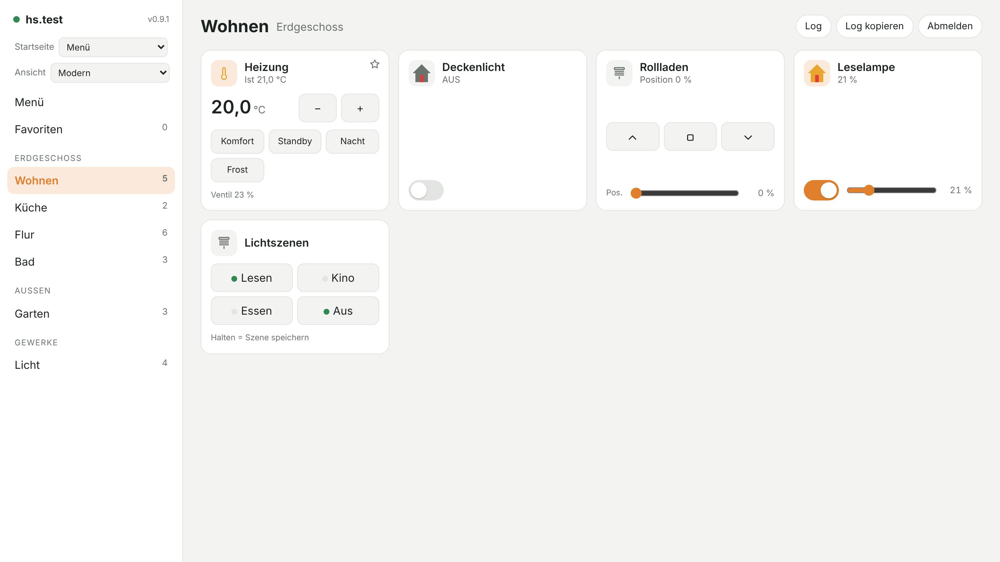
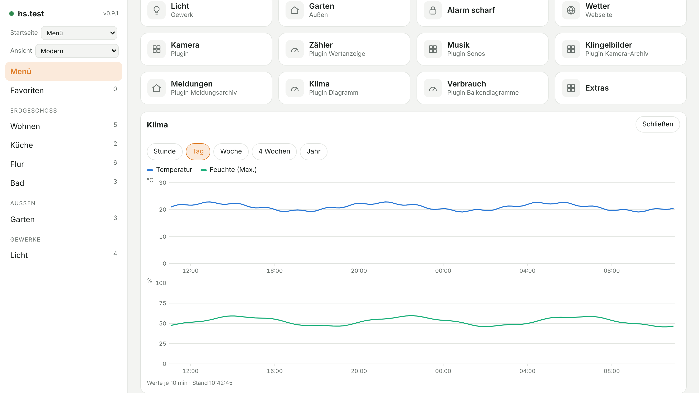
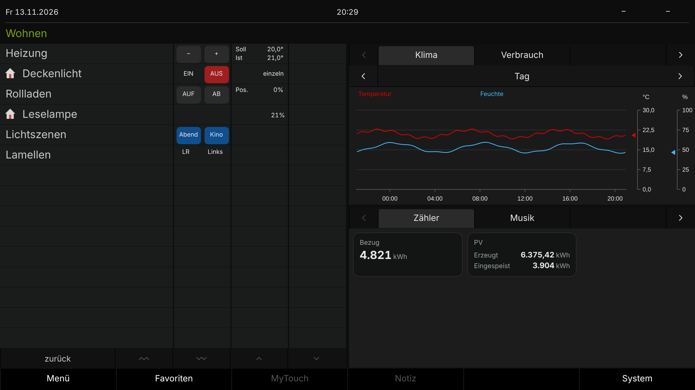
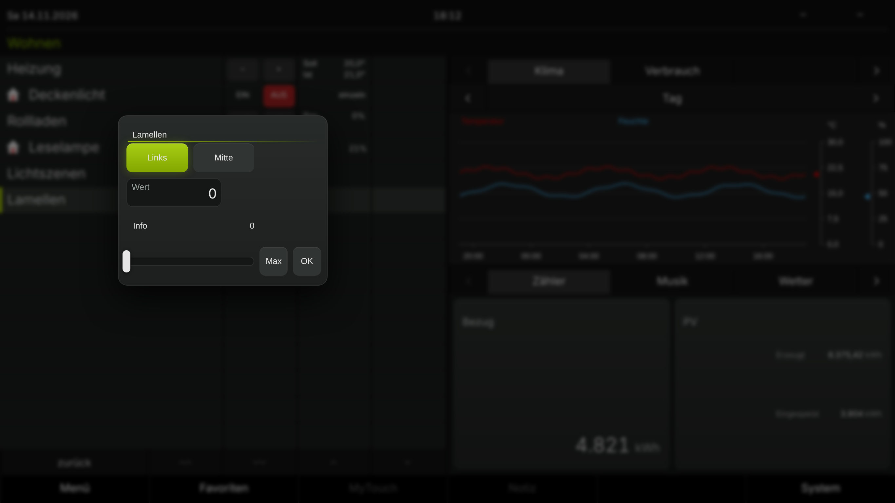
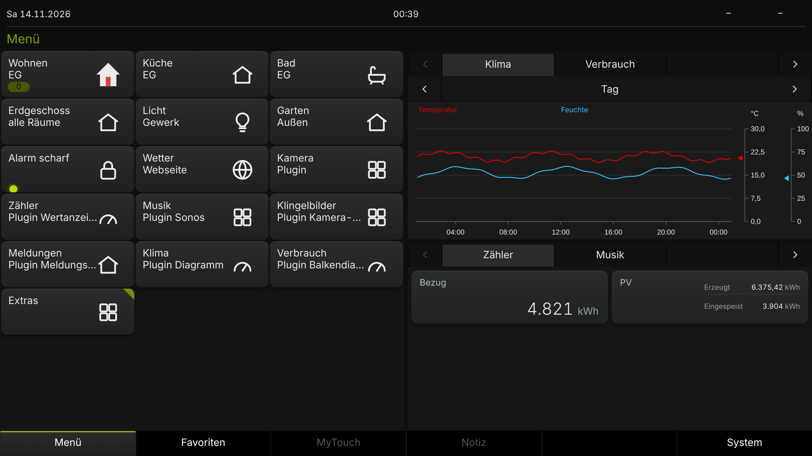
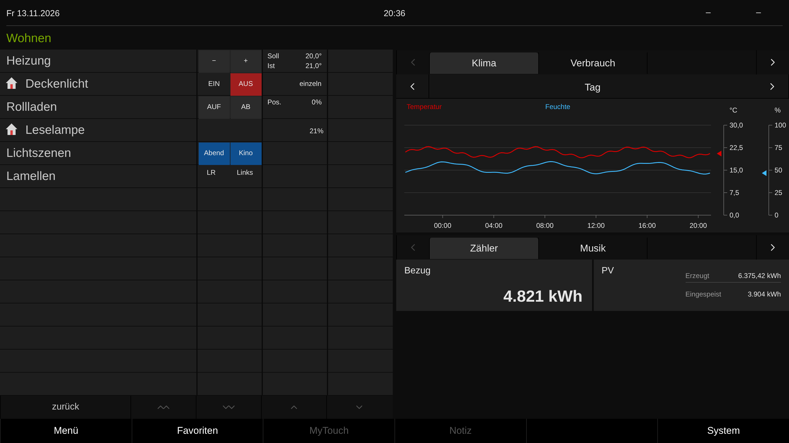
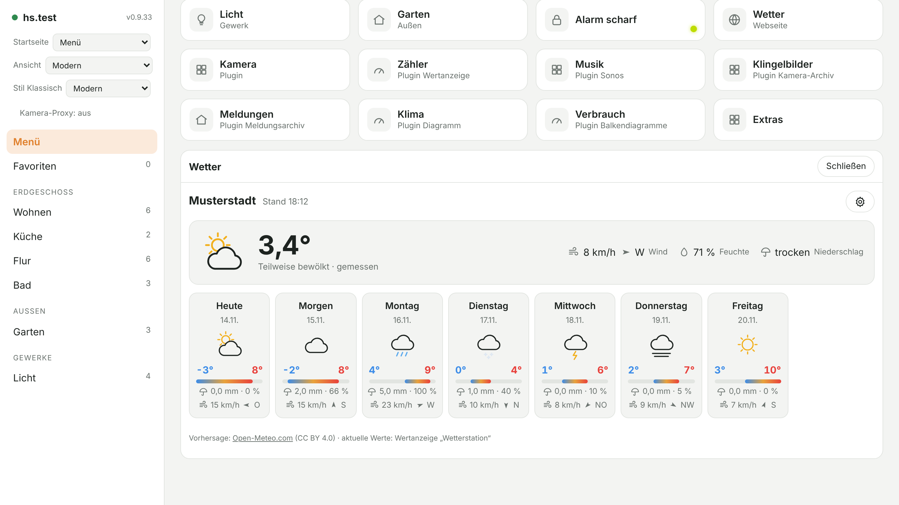
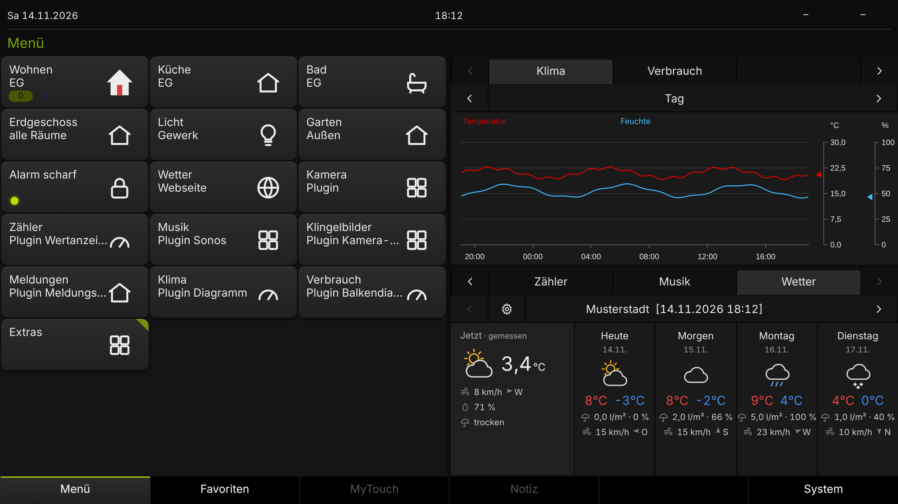

# QC-Client – der QuadClient im Browser

Ein moderner, freier Ersatz für den **Gira QuadClient** – als eine einzige HTML-Datei,
die direkt auf dem Gira HomeServer liegt und in jedem Browser läuft: Handy, Tablet, PC.

## Ziel

Wer seine Visualisierung schon im QuadClient aufgebaut hat, soll einfach **eine App** haben –
ohne Dateien hochzuladen, ohne CSV-Exporte, ohne Vorbereitung im Experten.

**Stufe 1 – QuadClient-Ersatz**
- Anmelden nur mit **HS-Adresse, Benutzer und Passwort**.
- Die **vorhandene QC-Visu** wird direkt vom HomeServer geladen (Räume, Gewerke, Menü,
  Funktionen, Schaltuhren), die **QC-Benutzerrechte** gelten unverändert.
- Besser als das Original: **schneller, moderner, besser bedienbar**, mit Funktionen, die
  dort fehlen, und tauglich für den **Fernzugriff**.

**Stufe 2 – „extended“ (optional, geplant)**
- Erweiterungen über eine eigene WebApp, das KO-Gateway und eigene HSL3-Logikbausteine –
  z. B. moderne Kameras (ONVIF), eigene Kacheln, eigene Seiten.

## Stand (v0.9.7)

- Menü als Startseite, Räume nach Etagen, Gewerke, Favoriten – mit den Symbolen aus der QC-Visu
- Schalten, Dimmen, Rollo, Heizung, RGB, Tunable White, Taster (alle Varianten), Szenen
  (abrufen/lernen), Schalten mit PIN, Werteingabe, Müll, Anzeigen
- Schaltuhren anzeigen, anlegen, ändern, löschen (Uhrzeit, Zufall, Sonnenauf-/-untergang,
  Wochentage, Sondertage)
- Webseiten aus dem Menü eingebettet, Plugins „Wertanzeige“, „Sonos“, „Kamera“, „Kamera-Archiv“, „Meldungsarchiv“, „Diagramm“ und „Balkendiagramme“ (weitere folgen)
- Zwei Ansichten: „Modern“ und „Klassisch“ (wie der Windows-QuadClient, Zeilen aus den Vorlagen des HS)
- Neustart-Erkennung, automatisches Wiederverbinden mit „Jetzt verbinden“, Hell/Dunkel, Handy-tauglich

## Beispielbilder

Aufgenommen mit der erfundenen Demo-Visu aus `test/` – keine echte Anlage
(neu erzeugen: `node test/screenshots.js`).

**Ansicht „Modern“** – Raum mit Heizung, Licht, Rollladen, Dimmer und Szenen



**Plugins** – hier „Diagramm“ mit Temperatur und Feuchte aus den HS-Archiven



**Ansicht „Klassisch“** – Aufbau wie der Windows-QuadClient (Zeilen links, Plugins in den Quadranten rechts), im Stil „Modern“: abgerundete Felder, moderne Schrift



**Popup aus der Vorlage** – Knöpfe, Wertfeld, Schieberegler; die angetippte Zeile bleibt markiert



**Menü** – plastische Kacheln mit Zählern und Zuständen



**Stil „Gira“** – dieselbe Seite so schlicht wie das Original (umschaltbar in den Einstellungen bzw. System → „Stil wechseln“)



**Wetter** – Vorhersage von Open-Meteo, „Jetzt“ mit den Werten der eigenen Wetterstation (Modern und Klassisch)





Alle Versionen: [`CHANGELOG.md`](CHANGELOG.md) · mit Bildern: [`changelog.html`](changelog.html) · Was noch kommt: [`ROADMAP.md`](ROADMAP.md) · Protokoll-Notizen: [`docs/protokoll.md`](docs/protokoll.md)

## Wetter (Plugin 1-3)

Der Client ersetzt den Gira-Wetterdienst durch eine eigene Lösung:

- **Vorhersage:** [Open-Meteo](https://open-meteo.com/) (kostenlos, ohne Schlüssel, CC BY 4.0). Den Ort wählt man einmal je Gerät über das Zahnrad (Ortssuche oder Gerätestandort).
- **Aktuelle Werte:** von einer Wetterstation am KNX (eigene oder Gira-Wetterstation, auch ein Logikbaustein). Angeschlossen wird sie über ein Plugin **Wertanzeige (1-2)** im Experten:
  1. QuadClient → Plugins → neue Wertanzeige anlegen, Titel z. B. „Wetterstation“ (enthält der Titel „Wetter“, wird sie automatisch genommen). „Im QC sichtbar“ darf aus sein.
  2. Einträge anlegen und die KOs zuweisen. Erkannt wird an der Bezeichnung (Gruppe + Wert):
     Temperatur/Außen, Wind (Geschwindigkeit), Windrichtung (Grad, 0 = Nord), Regen (1 Bit = Regen ja/nein, sonst Menge), Feuchte, Helligkeit, Luftdruck.
  3. Projekt übertragen. Im Client unter Zahnrad → „Aktuelle Werte von einer Wetterstation“ prüfen, welche Werte erkannt wurden.
- Aus den Gira-Plugin-Einstellungen gelten Aktualisierungsintervall und Einheiten; die Geräteportal-Kennung wird nicht verwendet.
- Ohne Internet bleibt die zuletzt geladene Vorhersage mit Zeitstempel stehen, die Stationswerte laufen weiter.

## Wetter (eigenes Plugin 99-1)

Wer das eigene Plugin „Wetter“ aus [QC-Plugin](https://github.com/BadSmiley0815/QC-Plugin) im Experten einrichtet (Ort, Einheiten, KOs der Wetterstation), bekommt dieselbe Anzeige ohne Eingabe am Gerät: Der Client liest die Einstellungen der Instanz vom HomeServer. Stationswerte haben Vorrang vor Open-Meteo; zusätzlich gibt es gefühlte Temperatur, Helligkeit je Himmelsrichtung und Luftdruck. Die ID 99-1 ist vorläufig (siehe unten).

## Eigene Funktionsvorlagen – vorläufige IDs

Vorlagen-IDs bestehen aus **Entwickler-ID + Nummer** (z. B. `1-101`: Entwickler 1 = Gira, Vorlage 101). Die Entwickler-ID vergibt Gira auf Anfrage.

Die hier verwendeten IDs **`99-…`** (Testvorlagen 99-3, 99-7 und das geplante Wetter-Plugin 99-1) sind **vorläufig**: Eine eigene Entwickler-ID ist bei Gira angefragt.
Sobald sie vergeben ist, werden alle eigenen Vorlagen in allen Dateien auf die neue ID umgestellt – Elemente, die eine 99-Vorlage verwenden, müssen danach im Experten neu zugewiesen werden.
Eigene Funktionsvorlagen liegen im Repository [QC-Funktionsvorlagen](https://github.com/BadSmiley0815/QC-Funktionsvorlagen), eigene Plugins in [QC-Plugin](https://github.com/BadSmiley0815/QC-Plugin).

## Installation auf dem HomeServer

1. `qc.html` im Experte-Projektordner ablegen unter
   `…\Projekte\<Projekt>\<Projekt>\hsupload\hs-client\qc.html`
2. Projekt übertragen.
3. Im Browser öffnen: `https://<HS-IP>/opt/hs-client/qc.html`
   (beim ersten Mal das Zertifikat des HomeServers bestätigen)
4. Mit einem QuadClient-Benutzer anmelden.

Zum Ausprobieren geht auch: `qc.html` lokal im Browser öffnen und die HS-Adresse eintragen.

## Android-App

Für Android gibt es eine kleine Hülle, die `qc.html` mitbringt und das Zertifikat des HomeServers einmal bestätigen lässt: Quelltext, Bau und Installation unter [`android/`](android/README.md). Die fertige APK hängt – sobald das erste Release gebaut ist – an den [Releases](https://github.com/BadSmiley0815/QC-Client/releases).

## Tests

Die Tests laufen gegen einen nachgebauten HomeServer mit einer erfundenen Demo-Visu
(`test/demo_project.xml`). Die erwarteten Befehle stammen aus Mitschnitten des Originals.

```
npm i playwright && npx playwright install chromium
node test/run-tests.js
```

## Werkzeuge

`tools/` – kleine Python-Helfer (Python 3, `pip install websockets`):

- `qc_test.py` – Anmeldung testen, Visu laden, Live-Werte anzeigen
- `qc_probe.py` – prüft, welche Anmeldeart der HS akzeptiert
- `qc2json.py` – wandelt eine `client_project.xml` in eine schlanke JSON-Datei
- `hsm-build.py` – baut aus eigenen SVG-Symbolen ein Symbolpaket (`.hsm`) für Funktionsvorlagen
  und packt es in die `.hst` (Aufbau wie bei Giras eigenen Vorlagen; braucht `rsvg-convert`)

## Lizenz

GNU General Public License v3.0 – siehe [`LICENSE`](LICENSE). Jeder darf den Client nutzen,
ändern und weitergeben; geänderte Fassungen müssen ebenfalls unter der GPL-3.0 offen bleiben.

## Hinweise

- Unabhängiges Projekt, **nicht von Gira** und nicht von Gira unterstützt. „Gira“,
  „HomeServer“ und „QuadClient“ sind Marken ihrer Inhaber.
- Enthält keinen Code, keine Grafiken und keine Dateien von Gira; die Schnittstelle wurde
  ausschließlich am eigenen Netzwerkverkehr beobachtet.
- Nutzung auf eigene Verantwortung – vor allem bei Schaltuhren und PIN-geschützten Funktionen.
- Nie Mitschnitte (`flows*`) oder echte Projektdateien einchecken – sie enthalten Zugangsdaten.
